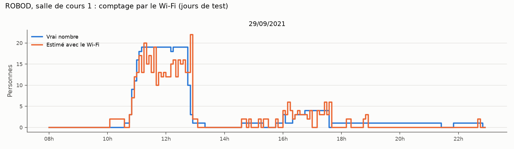
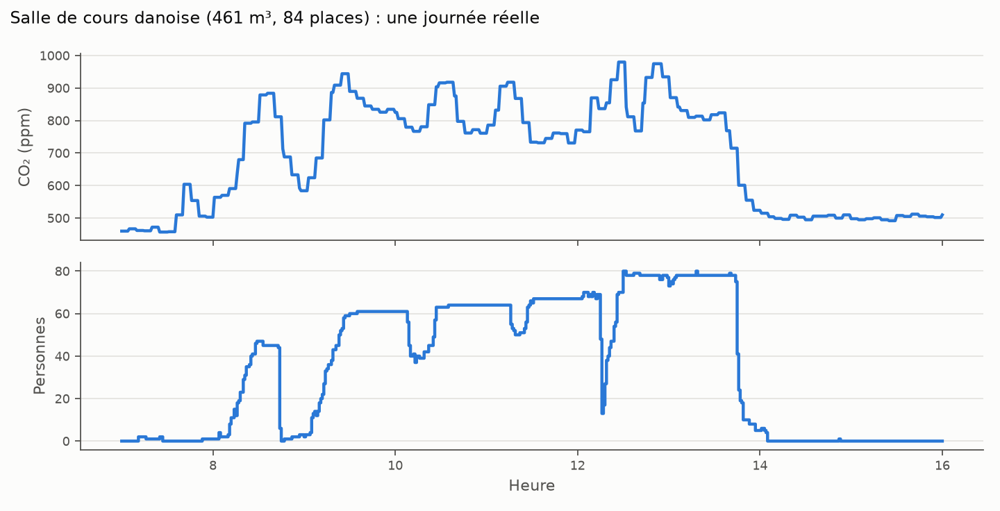
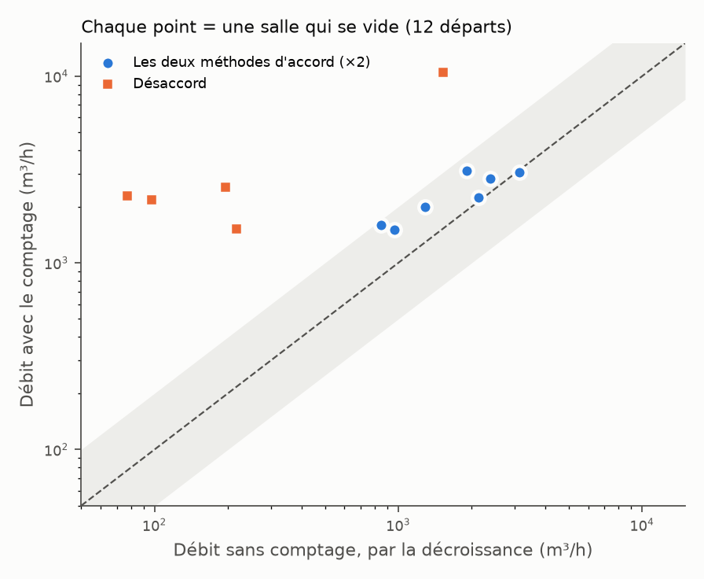

# CampusTwin — tests sur des données réelles

Jusqu'ici, le jumeau 3D tournait sur une salle simulée avec la même équation que notre estimateur. Le test ne pouvait que marcher. Ici, on teste nos deux idées sur de vraies salles de cours :

1. compter les personnes avec le Wi-Fi ;
2. retrouver le débit d'air réel avec le CO₂, de deux façons (avec et sans le comptage).

## Les données

| Jeu de données | Salles | Ce qu'il contient | Lien |
| --- | --- | --- | --- |
| ROBOD (Singapour, 2021) | 2 salles de cours, 2 bureaux, 1 bibliothèque | CO₂, appareils Wi-Fi, ventilation, vrai nombre de personnes, toutes les 5 min, 29 à 47 jours | [figshare](https://doi.org/10.6084/m9.figshare.19234530.v7), article : Tekler et al., *Building Simulation*, 2022 |
| OU44 (Danemark, 2018-2019) | 1 salle de cours de 461 m³ (84 places), 2 salles de travail | CO₂ (≈ 5 min), comptage par caméras aux portes, volet de ventilation, 44 jours | [figshare](https://doi.org/10.6084/m9.figshare.c.4505813), article : Schwee et al., *Scientific Data*, 2019 |

Les données ne sont pas dans le dossier. Pour relancer, télécharger les deux zip, les décompresser, puis :

```
python test_wifi_robod.py <dossier ROBOD>
python test_wifi_ia.py <dossier ROBOD>
python test_co2_salle_danoise.py <dossier Dataset OU44>
```

## Résultat 1 : le Wi-Fi compte à ±2 personnes près

Modèle le plus simple possible : personnes = a × appareils + b, réglé sur la moitié des jours, testé sur l'autre moitié.

| Salle | Erreur moyenne (salle occupée) | À ±2 près |
| --- | --- | --- |
| Salle de cours 1 | 2,2 pers. | 70 % |
| Salle de cours 2 | 3,4 pers. | 56 % |
| Bureau 1 | 2,3 pers. | 63 % |
| Bureau 2 | 2,0 pers. | 70 % |
| Bibliothèque | 2,2 pers. | 70 % |



- Le Wi-Fi suit bien le remplissage, mais il bruite (les téléphones se connectent et se déconnectent).
- Le coefficient change d'une salle à l'autre (0,6 à 1,4 personne par appareil). Utiliser tel quel le modèle d'une salle dans une autre donne 3,3 personnes d'erreur. **Pour tout l'IUT, chaque salle doit être recalée.** C'est le rôle de la salle équipée de capteurs à la porte.

### Une vraie IA fait-elle mieux ? ([test_wifi_ia.py](test_wifi_ia.py))

On a essayé un modèle d'apprentissage (gradient boosting) qui voit le Wi-Fi des 30 dernières minutes, l'heure et le jour.

| Salle | Droite | IA, même salle | IA apprise sur les 4 autres salles, sans recalage |
| --- | --- | --- | --- |
| Salle de cours 1 | 2,2 pers. (70 % à ±2) | 2,4 (67 %) | 2,2 (72 %) |
| Salle de cours 2 | 3,4 (56 %) | 4,5 (59 %) | 4,4 (51 %) |
| Bureau 1 | 2,3 (63 %) | 1,9 (72 %) | 1,8 (75 %) |
| Bureau 2 | 2,0 (70 %) | 1,6 (78 %) | 2,3 (64 %) |
| Bibliothèque | 2,2 (70 %) | 1,8 (75 %) | 1,8 (74 %) |

- L'IA gagne un peu dans les bureaux et la bibliothèque, pas dans les salles de cours. Le gain est faible : on ne peut pas dire que l'IA « compte » mieux que la droite.
- Le résultat utile pour tout l'IUT : **un modèle appris sur d'autres salles marche déjà dans une nouvelle salle**, sans réglage (sauf la salle 2, où même le CO₂ ne suit pas les personnes).
- Recaler une salle sur 1 à 3 jours peut faire **pire** que ne rien faire (salle de cours 1 : 4,7 personnes d'erreur au lieu de 2,2), car les premiers jours ne ressemblent pas aux suivants. Le serveur part donc du modèle commun et ne s'en éloigne que peu à peu, avec des semaines de badges ([serveur/salle.py](../serveur/salle.py), `ModeleWifi`).

## Résultat 2 : le CO₂ marche, mais moins bien qu'en simulation



À chaque fois que la salle danoise se vide, on calcule le débit d'air comme dans le jumeau :
- **avec le comptage**, sur les 30 min avant les départs ;
- **sans le comptage**, par la décroissance du CO₂ dans les 16 min qui suivent.



- 12 départs exploitables. Sur 7 d'entre eux, les deux débits sont d'accord à un facteur 2 près, avec un rapport médian de 1,55 (de 1,0 à 1,9). Les débits trouvés (1 000 à 3 000 m³/h, soit 2 à 7 volumes par heure) sont réalistes pour cette salle.
- Sur 5 départs, la décroissance donne un débit beaucoup trop faible. Causes probables : le CO₂ n'est mesuré que toutes les 5 min, donc il n'y a que 3 ou 4 points pour la décroissance, et le volet change pendant la décroissance.
- L'écart de 1,55 est le même d'un départ à l'autre : c'est un biais propre à la salle (production réelle de CO₂ par personne, placement du capteur). Il se corrige par un recalage.
- Le niveau de la salle vide varie de 424 à 554 ppm selon les jours. Le capteur dérive vraiment : notre vérification de la dérive est utile.

Dans ROBOD, le test CO₂ ne marche pas : les salles sont très ventilées et presque vides (7 personnes en moyenne), donc le CO₂ ne monte que de 30 à 100 ppm. Dans une salle, le CO₂ ne suit même pas le nombre de personnes (capteur mal placé).

## Ce que ça change pour le projet

1. **Mesurer le CO₂ souvent.** Le SCD-41 mesure toutes les 5 s. On enregistre au moins une valeur par minute, sinon la décroissance est inutilisable.
2. **Une phase de recalage par salle (2 semaines).** On apprend le biais entre les deux méthodes (ici 1,55) et le coefficient du Wi-Fi. Les seuils du diagnostic sont fixés à partir de la dispersion réelle, pas à la main.
3. **Décider sur plusieurs départs, pas un seul.** Un départ seul varie trop (après recalage, de 0,6 à 1,2). En prenant la médiane de plusieurs départs, un comptage faux de 50 % devrait se voir. Avec seulement 7 bons départs ici, c'est encore à confirmer sur notre propre salle.
4. **Ajouter une 5ᵉ cause : capteur mal placé.** Le CO₂ ne réagit pas aux personnes comptées.
5. **La méthode sert surtout là où l'air est mauvais.** Quand une salle est très ventilée, le CO₂ bouge trop peu pour mesurer le débit, mais on sait que l'air est bon. On le dit tel quel.
